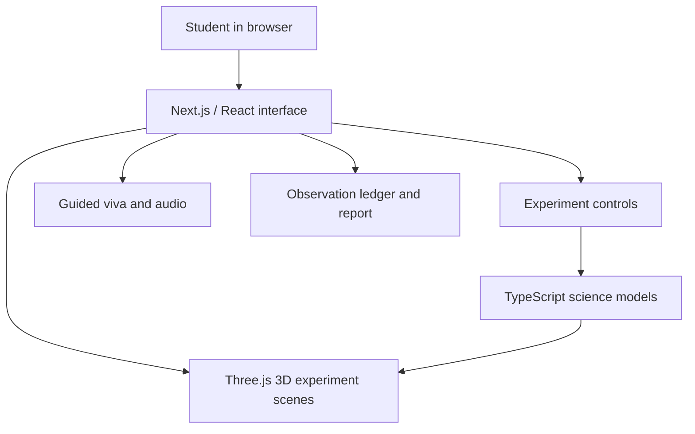

🔬 LabSim
An interactive virtual science laboratory for school STEM education
Explore physics and chemistry experiments in an interactive 3D browser environment.

  
  
  
  

  <a href="https://github.com/Saraththecoder/labsim"><strong>Repository</strong></a>
  · <a href="#-experiments">Experiments</a>
  · <a href="#-getting-started">Get started</a>
  · <a href="#-roadmap">Roadmap</a>

Project status: Academic / development project. Features and browser support should be considered experimental until verified on target devices.

✨ What is LabSim?
LabSim is a browser-based virtual laboratory concept designed to help secondary and senior-secondary students explore school-level science experiments through interactive 3D models, adjustable experiment parameters, visual feedback, and guided viva preparation.

The project focuses on making practical concepts easier to explore when access to physical laboratory equipment is limited. It is intended to complement—not replace—supervised, hands-on laboratory learning.
🧪 Explore the lab
Physics	Chemistry
🔎 Convex lens — focal length and image formation	⚡ Electrolytic conductivity — ions, electrodes, and conductivity concepts
🪞 Concave mirror — real and virtual images	🧪 Acids, bases & indicators — observe indicator colour changes
🔌 Ohm’s law — voltage, current, and resistance	🧲 Metal displacement — explore a reaction between iron and copper sulphate
🌈 Glass prism — refraction and dispersion	
📐 Glass slab — refraction and lateral displacement	
🧰 Circuit sandbox — assemble and explore circuit components	

The availability and completeness of each experiment may vary by build. Confirm the current implementation in the application before using it for teaching or assessment.

🖥️ Visual preview
Add current screenshots from the running application to docs/images/ and update the paths below. Real screenshots are more useful than mockups for evaluating an interactive project.

3D laboratory	Circuit sandbox
	
Replace with a current screenshot of the lab.	Replace with a current screenshot of the sandbox.

🧠 Learning support
- Interactive visualisation: explore experiment setups and observe how parameter changes affect the displayed result.
- Guided viva preparation: review experiment tips, sample oral questions, and explanations.
- Circuit feedback: explore circuit arrangements and visual current behaviour in the sandbox.
- Observation and report workflow: use the available observation ledger and printable report features where implemented.
- Browser-first access: use a compatible modern browser without installing a separate native application for the standard web experience.
Important limitations
- A visual simulation is a model, not a substitute for laboratory measurements or safety training.
- Immersive WebXR/AR depends on browser, operating-system, and device support; a regular 3D view should be provided where AR is unavailable.
- Voice output depends on browser speech support and device settings. Any model-powered AI features should document their model, connectivity requirements, and data handling separately.
- Offline access applies only to assets and functions correctly cached or implemented for offline use. Do not assume every feature works without a network connection.
🧱 Technology stack
Layer	Technologies described in this project
Web application	Next.js, React, TypeScript
3D rendering	Three.js, WebGL
Spatial experience	WebXR Device API where supported
UI and styling	Tailwind CSS, Lucide icons, GSAP animations
Validation and local persistence	Zod, browser LocalStorage
Voice and audio	Web Speech API, Web Audio API
Scientific calculations	Custom TypeScript modules for optics, circuits, refraction, and conductivity

Version note: Use the versions in package.json and the lockfile as the source of truth. Update this table if the implementation changes.

🏗️ Architecture at a glance

The application is organised around experiment pages, reusable 3D components, and separate calculation modules. Keep scientific calculations independent from rendering wherever practical so they can be tested without launching a 3D scene.
🚀 Getting started
Prerequisites
- Node.js version supported by the current Next.js project (Node.js 20 or newer is a sensible starting point; check the installed Next.js requirements).
- npm, pnpm, or the package manager indicated by the repository lockfile.
- A modern browser with WebGL enabled for 3D experiments.
Install and run
git clone https://github.com/Saraththecoder/labsim.git
cd labsim
npm install
npm run dev
Open the local URL printed by the development server—typically http://localhost:3000 unless the port is configured differently.
Create a production build
npm run build
npm run start
Run the project's linting and tests as configured in package.json. Build success alone does not validate scientific correctness, device performance, or learning outcomes.
Environment variables
If an experiment or optional service requires an API key, document its variable name in an .env.example file. Never commit real API keys, tokens, or credentials. If the application does not require environment variables, state that explicitly.
📁 Project structure
The following is a representative structure based on the project documentation; update it to match the current repository exactly.
labsim/
├── public/
│   └── assets/                 # Static images and visual assets
├── src/
│   ├── app/                    # App routes and experiment pages
│   │   ├── lab/                # Convex lens lab
│   │   ├── physics/            # Physics experiments
│   │   ├── chemistry/          # Chemistry experiments
│   │   ├── sandbox/            # Circuit sandbox
│   │   ├── observations/       # Observation ledger
│   │   └── report/             # Printable report
│   ├── components/             # Reusable UI and 3D components
│   └── lib/                    # Scientific calculations and utilities
├── docs/
│   └── images/                 # README screenshots
├── package.json
└── README.md
🔬 Scientific accuracy and validation
LabSim includes models for optics, circuits, refraction, and electrolyte concepts. For educational use, each experiment should clearly state its assumptions and units, and should be checked against known results.

Recommended validation checklist:
- [ ] Unit-test equations and edge cases (for example, lens positions near the focal point).
- [ ] Check circuit calculations against independently calculated voltage, current, and resistance values.
- [ ] Validate refraction and prism output against Snell’s law and defined geometry.
- [ ] State the assumptions and concentration range used by conductivity models.
- [ ] Verify visual output on supported mobile and desktop browsers.
- [ ] Clearly label simulated readings and avoid presenting them as physical measurements.
⚡ Performance and compatibility
Performance varies with device hardware, browser, scene complexity, screen resolution, and power settings. Publish measured FPS, memory use, load times, and WebXR results only when accompanied by a repeatable test method.
Area	What to document
Device	Exact phone, tablet, or computer model
Browser	Name and version
Scene	Experiment and rendering settings tested
Measurement	Tool used, duration, and repeated-run results
AR support	Whether immersive AR was actually tested on the device

🗺️ Roadmap
- [ ] Add verified screenshots and a hosted demo link.
- [ ] Expand automated tests for scientific calculations.
- [ ] Publish a browser/device compatibility matrix.
- [ ] Document offline behaviour and the features that require connectivity.
- [ ] Add accessible controls, keyboard navigation, and reduced-motion support.
- [ ] Evaluate learning outcomes through a documented student study before publishing educational impact claims.
📚 References
- NCERT — curriculum and laboratory learning resources.
- Three.js documentation — 3D rendering.
- WebXR Device API — immersive web experiences and platform limitations.
- Next.js documentation — framework setup and deployment.
- Hecht, Eugene. Optics, 5th edition, Pearson, 2017.
- Atkins, Peter and de Paula, Julio. Physical Chemistry, 11th edition, Oxford University Press.
Use the specific NCERT manual or textbook edition relevant to each experiment when making curriculum-alignment claims.
🤝 Contributing
Contributions are welcome. Before opening a pull request:
1. Explain the problem or proposed improvement.
2. Keep scientific calculations separate from presentation logic where possible.
3. Include tests or reproducible steps for changes to equations and experiment behaviour.
4. Include screenshots for significant UI changes.
5. Never include secrets or personal data in commits.
📄 License
The project documentation identifies the intended license as MIT. Include a valid LICENSE file in the repository before presenting the project as MIT-licensed.
👨‍💻 Maintainer
Sarath · @Saraththecoder

Making science concepts more visual, interactive, and approachable.

Built as an educational technology project.

