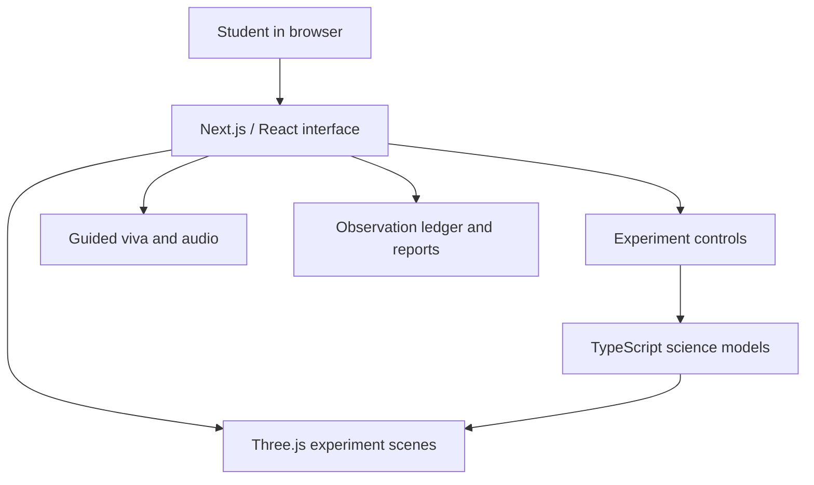

🔬 LabSim
Interactive Virtual Science Laboratory
Explore school-level physics and chemistry through browser-based 3D experiments, guided explanations, and circuit simulations.

  
  
  
  

Experiments · Features · Installation · Architecture · Roadmap

Project status: Academic / development project. Feature availability and device compatibility should be verified against the current build.

📌 Overview
LabSim is a browser-based virtual laboratory concept designed to help secondary and senior-secondary students explore science experiments through interactive 3D models, adjustable parameters, visual feedback, and guided viva preparation.

It aims to complement classroom teaching and supervised practical work—not replace hands-on laboratory learning.
🧪 Experiments
Physics
Experiment	Learning focus
🔎 Convex lens	Focal length and image formation
🪞 Concave mirror	Real and virtual images
🔌 Ohm's law	Voltage, current, and resistance
🌈 Glass prism	Refraction and dispersion
📐 Glass slab	Refraction and lateral displacement
🧰 Circuit sandbox	Building and exploring circuit arrangements

Chemistry
Experiment	Learning focus
⚡ Electrolytic conductivity	Ions, electrodes, and conductivity concepts
🧪 Acids, bases, and indicators	Observe indicator colour changes
🧲 Metal displacement	Explore the iron and copper sulphate reaction

The availability and completeness of each experiment may vary by build. Confirm the current implementation in the application before using it for teaching or assessment.

🖼️ Screenshots
Add real screenshots from the running application to docs/images/, then update these paths. GitHub will show the images once the files exist in the repository.
<table>
  <tr>
    <td align="center" width="50%"><strong>3D Laboratory</strong></td>
    <td align="center" width="50%"><strong>Circuit Sandbox</strong></td>
  </tr>
  <tr>
    <td align="center" width="50%"></td>
    <td align="center" width="50%"></td>
  </tr>
</table>

✨ Features
- Interactive 3D visualisation — explore experiment setups and adjust supported parameters.
- Guided viva preparation — review experiment tips, sample oral questions, and explanations.
- Circuit feedback — explore circuit arrangements and visual current behaviour in the sandbox.
- Observation and report workflow — use the observation ledger and printable report where implemented.
- Browser-first access — use a compatible modern browser for the standard web experience.
Limitations to keep in mind
- A visual simulation is a model, not a substitute for laboratory measurements or safety training.
- WebXR/AR depends on browser, operating-system, and device support. A regular 3D view should remain available where immersive AR is unsupported.
- Voice output depends on browser speech support and device settings. Any model-powered AI feature should document its model, connectivity needs, and data handling.
- Offline access applies only to assets and functions that are correctly cached or implemented for offline use.
🧱 Technology stack
Layer	Technologies
Web application	Next.js, React, TypeScript
3D rendering	Three.js, WebGL
Spatial experience	WebXR Device API, where supported
UI and styling	Tailwind CSS, Lucide icons, GSAP animations
Validation and local persistence	Zod, browser LocalStorage
Voice and audio	Web Speech API, Web Audio API
Scientific calculations	Custom TypeScript modules for optics, circuits, refraction, and conductivity

Version note: Use package.json and the lockfile as the source of truth for installed versions.

🏗️ Architecture

Keep scientific calculations separate from rendering where practical. This makes the calculations easier to test without launching a 3D scene.
🚀 Getting started
Prerequisites
- Node.js version supported by the current Next.js project. Check the installed Next.js version's requirements.
- npm, pnpm, or the package manager indicated by the repository lockfile.
- A modern browser with WebGL enabled for 3D experiments.
Install and run
git clone https://github.com/Saraththecoder/labsim.git
cd labsim
npm install
npm run dev
Open the local URL printed by the development server. It is typically http://localhost:3000, unless the port is configured differently.
Production build
npm run build
npm run start
Run the project's linting and tests as configured in package.json. A successful build alone does not validate scientific correctness, device performance, or learning outcomes.
Environment variables
If an experiment or optional service requires an API key, document the variable name in .env.example. Never commit real API keys, tokens, or credentials. If no environment variables are required, state that explicitly.
📁 Project structure
The following is a representative structure based on the project documentation. Update it to match the current repository before publishing.
labsim/
├── public/                  # Static assets
├── src/
│   ├── app/                 # App routes and experiment pages
│   │   ├── lab/             # Convex lens lab
│   │   ├── physics/         # Physics experiments
│   │   ├── chemistry/       # Chemistry experiments
│   │   ├── sandbox/         # Circuit sandbox
│   │   ├── observations/    # Observation ledger
│   │   └── report/          # Printable report
│   ├── components/          # Reusable UI and 3D components
│   └── lib/                 # Scientific calculations and utilities
├── docs/
│   └── images/              # README screenshots
├── package.json
└── README.md
🔬 Scientific validation
Each experiment should state its assumptions and units and be checked against known results before being used for instruction or assessment.
- [ ] Unit-test equations and edge cases, including lens positions near the focal point.
- [ ] Check circuit calculations against independently calculated voltage, current, and resistance values.
- [ ] Validate refraction and prism output against Snell's law and the defined geometry.
- [ ] State assumptions and concentration ranges used by conductivity models.
- [ ] Verify visual output on supported mobile and desktop browsers.
- [ ] Label simulated readings clearly; do not present them as physical measurements.
⚡ Performance and compatibility
Performance varies with device hardware, browser, scene complexity, screen resolution, and power settings. Publish FPS, memory, load-time, or WebXR results only with a repeatable test method.
Record	Details to include
Device	Exact phone, tablet, or computer model
Browser	Name and version
Scene	Experiment and rendering settings tested
Measurement	Tool, test duration, and repeated-run results
AR support	Whether immersive AR was tested on that device

🗺️ Roadmap
- [ ] Add verified screenshots and a hosted demo link.
- [ ] Expand automated tests for scientific calculations.
- [ ] Publish a browser and device compatibility matrix.
- [ ] Document offline behaviour and features that require connectivity.
- [ ] Improve accessible controls, keyboard navigation, and reduced-motion support.
- [ ] Evaluate learning outcomes through a documented student study before publishing educational impact claims.
📚 References
- NCERT — curriculum and laboratory learning resources.
- Three.js documentation — 3D rendering.
- WebXR Device API — immersive web experiences and platform limitations.
- Next.js documentation — framework setup and deployment.
- Hecht, Eugene. Optics, 5th edition, Pearson, 2017.
- Atkins, Peter and de Paula, Julio. Physical Chemistry, 11th edition, Oxford University Press.
Use the specific NCERT manual or textbook edition relevant to each experiment when making curriculum-alignment claims.
🤝 Contributing
Contributions are welcome. Before opening a pull request:
1. Explain the problem or proposed improvement.
2. Keep scientific calculations separate from presentation logic where possible.
3. Include tests or reproducible steps for changes to equations or experiment behaviour.
4. Include screenshots for significant UI changes.
5. Never include secrets or personal data in commits.
📄 License
The project documentation identifies the intended license as MIT. Add a valid LICENSE file before presenting the project as MIT-licensed.
👨‍💻 Maintainer
Sarath · @Saraththecoder

Making science concepts more visual, interactive, and approachable.

Built as an educational technology project.

